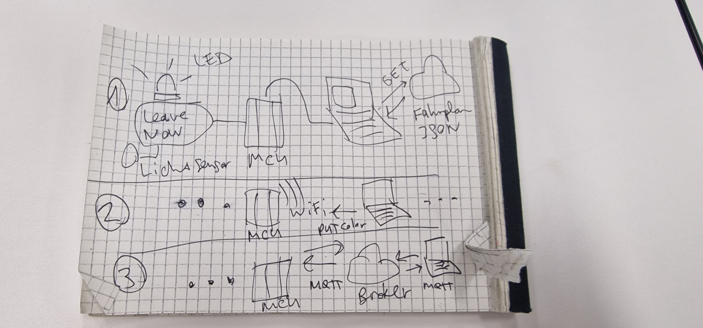

# FHNW (ipro) Smart Stop Display

FHNW (ipro) is a mandatory individual software project, worth 6 ECTS.

An ESP32 shows the next departure of one public transport line on a 16x2 RGB
LCD. It pulls live data from the Swiss [transport.opendata.ch] API, keeps time
over NTP, and dims its backlight with an ambient light sensor. Wi-Fi and the
stop/line to watch are configured from a browser — no re-flashing, no
credentials in source.




## Features

- Live departure countdown for a single line, refreshed every 30 s
- Browser-based Wi-Fi provisioning: the display opens its own setup access
  point when it has no credentials or cannot connect
- Browser-based line picker: search a departure stop and destination, pick from
  the direct lines that actually run between them
- Settings survive a power cycle (stored in NVS)
- Ambient-light-controlled backlight brightness
- Reachable at `http://smartstop.local` via mDNS once on the network

## Hardware

| Part | Notes |
| --- | --- |
| ESP32 DevKit v1 *or* [Unexpected Maker FeatherS3] | both board environments are defined in `platformio.ini` |
| Grove 16x2 LCD RGB Backlight | I2C, address 0x3E (LCD) / 0x62 (RGB) |
| Photoresistor / LDR + resistor divider | analog in, GPIO 34 |

### Wiring

| LCD / sensor | ESP32 DevKit v1 |
| --- | --- |
| LCD VCC | 5V |
| LCD GND | GND |
| LCD SDA | GPIO 21 |
| LCD SCL | GPIO 22 |
| LDR divider output | GPIO 34 |
| LDR divider VCC / GND | 3V3 / GND |

## Build and flash

Requires [PlatformIO] (CLI, or the CLion / VS Code plugin).

```bash
pio run -e esp32devkit -t upload
```

The web UI lives in `data/` and is served from a LittleFS partition, so it has
to be uploaded separately — **once, and again after every change under
`data/`**:

```bash
pio run -e esp32devkit -t uploadfs
```

Serial log:

```bash
pio device monitor
```

### Build environments

| Environment | Board | Log level |
| --- | --- | --- |
| `esp32devkit` | `esp32doit-devkit-v1` | verbose (`CORE_DEBUG_LEVEL=4`) |
| `esp32devkit_release` | `esp32doit-devkit-v1` | silent (`CORE_DEBUG_LEVEL=0`) — deployment build |
| `um_feathers3` | `um_feathers3` | info (`CORE_DEBUG_LEVEL=3`) |

`platformio.ini` pins `upload_port` and `monitor_port` to `COM8`. Change both
to match your machine, or delete the lines to let PlatformIO autodetect.

## First run

1. Power the board. With no stored credentials it opens an access point:

   | SSID | Password | Address |
      | --- | --- | --- |
   | `SmartStop-Setup` | `smartstop` | `http://192.168.4.1` |

   The LCD shows `WiFi setup:` and the IP.
2. Join that network, open `http://192.168.4.1/wifi.html`, enter your home
   SSID and password, and hit **Save and restart**.
3. The display reboots and joins your network. Open `http://smartstop.local`
   (or the IP from the serial log).
4. Type a departure stop under **From** and a destination under **To**, picking
   both from the autocomplete list. Press **Find direct lines**, choose one,
   and **Save to display**.

The display picks up the new line on its next refresh.

If the display cannot join the stored network within 30 seconds it falls back
to the setup access point on its own.

## HTTP API

Served by the device on port 80.

| Method | Path | Body | Purpose |
| --- | --- | --- | --- |
| `GET` | `/config` | — | current `stopId`, `line`, `category`, `nextStop` as JSON |
| `POST` | `/save` | `{"stopId":8576646,"line":"10","category":"T","nextStop":"Bern, Bundesplatz"}` | store the line to watch; `stopId`, `line` and `nextStop` are required |
| `POST` | `/wifi` | `{"ssid":"…","pass":"…"}` | store Wi-Fi credentials, then reboot |
| `POST` | `/forget` | — | clear Wi-Fi credentials, then reboot into setup mode |

Ready-made requests live in `tools/postman/`.

## Configuration

Defaults come from `include/Config.h` and are overwritten by whatever is stored
in NVS.

| Key | Default | Meaning |
| --- | --- | --- |
| `stopId` | `8576646` | opendata.ch station id of the departure stop |
| `line` | `10` | line number to watch |
| `category` | `""` | vehicle category (`T`, `B`, `IR`, …); empty matches any |
| `nextStop` | `Bern, Bundesplatz` | the stop *after* yours — this is what selects the direction |
| `limit` | `30` | departures requested per API call |
| `refreshSec` | `30` | seconds between API calls |
| `r`, `g`, `b` | `64, 224, 208` | LCD backlight colour |

Only the first four are writable over HTTP today.

## Architecture

```
main.cpp            wiring and the super-loop
├── Config          persisted settings (NVS "cfg")
├── hardware/
│   ├── Display     16x2 RGB LCD, text formatting and brightness
│   └── LightSensor smoothed LDR reading → 0..1 brightness factor
├── net/
│   ├── WifiService lifecycle: normal ↔ provisioning mode
│   │   ├── WifiStore    credentials in NVS ("wifi")
│   │   ├── WifiManager  connect, retry, give up, mDNS
│   │   └── Provisioner  setup access point
│   ├── WebServer   LittleFS mount + static file serving
│   ├── ConfigRoutes /config, /save
│   └── WifiRoutes   /wifi, /forget
└── transport/
    ├── TransportApi     HTTP GET against the stationboard endpoint
    ├── DepartureParser  JSON → the first matching Departure
    ├── TimeService      NTP sync and ISO-8601 → minutes remaining
    └── TransportClient  refresh loop tying the three together
```

Route modules are registered before the static-file catch-all, and a reboot
requested from an HTTP handler is deferred to the main loop rather than taken
inside the handler.

See [docs/IPRO_Architecture.svg](docs/IPRO_Architecture.svg) for the diagram.

## Components and Language
https://esp32s3.com/feathers3.html

## Repository layout

| Path | Contents |
| --- | --- |
| `src/`, `include/` | firmware sources |
| `data/` | web UI uploaded to LittleFS |
| `docs/` | architecture, technical documentation, user manual, worklog |
| `tools/postman/` | API collection and environments |
| `tools/SerialDisplay/`, `tools/WifiScan/` | standalone Arduino sketches used while prototyping |
| `test/` | unit tests (empty for now) |

## Documentation

- [Technische Dokumentation](docs/Technische%20Dokumentation.docx)
- [Benutzeranleitung](docs/Benutzeranleitung.docx)
- [WifiQRCodes](docs/WifiQRCodes.docx)
- [Worklog](docs/Worklog.md)
- [Gantt chart](docs/Gantt%20chart.xlsx)

## Troubleshooting

| Symptom | Cause |
| --- | --- |
| LCD stuck on `searching...` | no Wi-Fi, or NTP has not synced yet — the countdown needs real time |
| Browser shows nothing on port 80 | the LittleFS image was never uploaded (`pio run -t uploadfs`) |
| `smartstop.local` does not resolve | mDNS unavailable on your network; use the IP from the serial log |
| Wrong direction shown | `nextStop` selects the direction — re-pick the line in the web UI |
| Back on `SmartStop-Setup` after a reboot | the stored network was unreachable for 30 s |


## Known issues

- `LightSensor::init()` is never called from `main.cpp`, so the ADC pin is left
  at its defaults and the sensor pin is not configurable
- `limit`, `refreshSec` and the backlight colour are persisted but cannot be
  changed over HTTP
- the setup access point uses a fixed, published password
- `test/` contains no tests

## AI tools

https://chatgpt.com/g/g-p-69754f194c0081919a00ac923cd94c22-ipro/project

For the best experience: Download the folder and navigate the files by opening idnex.html
https://fhnw365-my.sharepoint.com/:u:/g/personal/severin_freuler_students_fhnw_ch/IQACLKwxPYbnTIkFcKB1bjOOAT2-3-1lxSWNpBZK8iGR-7Q?e=1JEjro


## License
Unless noted otherwise.

* Source code examples in this repository are declared Public Domain [CC0 1.0](https://creativecommons.org/publicdomain/zero/1.0/)
* Content by [A. Kennel](https://www.fhnw.ch/de/personen/andrea-kennel), [G. Deck](https://www.fhnw.ch/en/people/klaus-georg-deck), [T. Amberg](https://www.fhnw.ch/en/people/thomas-amberg), FHNW is licensed under [CC BY-SA 4.0](https://creativecommons.org/licenses/by-sa/4.0/)

Publishing your own code?

* [Choose an open source license](https://choosealicense.com/), e.g. the simple [MIT License](https://choosealicense.com/licenses/mit/)
